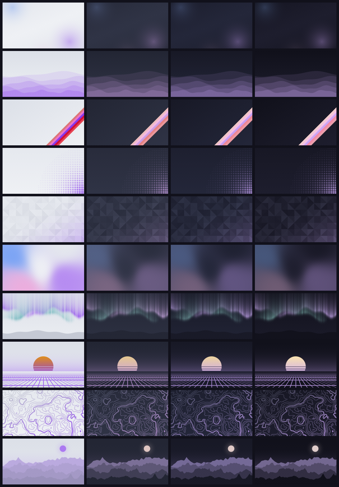

# catppuccin-cosmic-setup

[](https://github.com/Lucas-BRT/catppuccin-cosmic-setup/actions/workflows/ci.yml)
[](https://github.com/Lucas-BRT/catppuccin-cosmic-setup/releases)
[](LICENSE)
[](https://system76.com/cosmic)
[](ctp-cosmic)
[](scripts)

One-command [Catppuccin](https://catppuccin.com) setup for Pop!_OS 24.04
(COSMIC), in any of the 4 flavors and 14 accents.



## Install

```bash
curl -fsSL https://github.com/Lucas-BRT/catppuccin-cosmic-setup/releases/latest/download/install.sh | bash
```

In a terminal this opens an interactive setup with a live preview. To
install directly instead, pass the options:

```bash
curl -fsSL https://github.com/Lucas-BRT/catppuccin-cosmic-setup/releases/latest/download/install.sh | FLAVOR=latte ACCENT=blue bash
```

The `ctp-cosmic` binary is installed in `~/.local/bin`: run `ctp-cosmic`
later to change flavor, accent or steps, `ctp-cosmic update` to get a newer
release.

Your settings are backed up first, and `ctp-cosmic uninstall` puts back
exactly what the install changed. Add `--dry-run` to `apply` to see what it
would do first. Options and wallpaper styles are in
[docs/USAGE.md](docs/USAGE.md).

### Installing a pinned version

`curl | bash` runs whatever the release holds, so for a reviewed install pin
the version and the binary's hash (it is in the release's `SHA256SUMS`):

```bash
V=v0.8.0
curl -fsSL https://github.com/Lucas-BRT/catppuccin-cosmic-setup/releases/download/$V/install.sh -o install.sh
less install.sh   # read it
CATPPUCCIN_SETUP_VERSION=$V CATPPUCCIN_SETUP_SHA256=<hash of the binary for your arch> bash install.sh
```

Every release binary carries a signed provenance attestation:
`gh attestation verify FILE --repo Lucas-BRT/catppuccin-cosmic-setup`
(`install.sh` runs it by itself when `gh` is installed;
`CATPPUCCIN_SETUP_VERIFY=1` makes a failure fatal).

## What it sets up

- **Desktop theme** with Frosted Glass support
- **COSMIC Terminal** color scheme
- **Bash prompt** with git branch, in the flavor's colors (bash only: zsh and
  fish are not configured)
- **Apps**, only if you name them: Firefox, and any app you describe in a
  small manifest ([docs/APPS.md](docs/APPS.md))
- **Papirus icons** with Catppuccin folders, only if you ask for them
  (COSMIC's own icons stay by default; see [docs/USAGE.md](docs/USAGE.md#icons-optional))
- **Wallpapers** in 50 styles, also available in COSMIC's wallpaper picker
- **GTK and Flatpak apps** (optional) following the COSMIC theme
- **Zed** theme and icon configuration (preserves your settings.json comments)

## Credits

This is a community project, not an official Catppuccin port; see
[catppuccin/cosmic-desktop](https://github.com/catppuccin/cosmic-desktop)
for that. Palette by [Catppuccin](https://github.com/catppuccin/catppuccin),
icons by [Papirus](https://github.com/PapirusDevelopmentTeam/papirus-icon-theme)
and [catppuccin/papirus-folders](https://github.com/catppuccin/papirus-folders),
downloaded at install time.
