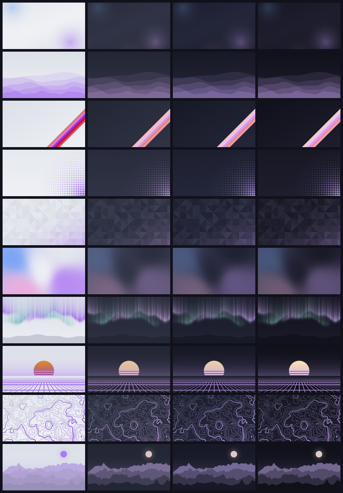

# catppuccin-cosmic-setup

[](https://github.com/Lucas-BRT/catppuccin-cosmic-setup/actions/workflows/ci.yml)
[](https://github.com/Lucas-BRT/catppuccin-cosmic-setup/releases)
[](LICENSE)
[](https://system76.com/cosmic)
[](wallpaper)
[](scripts)
[](themes)

[Catppuccin](https://catppuccin.com) for Pop!_OS 24.04 with the COSMIC
desktop, in one command: desktop theme, terminal, bash prompt, icons and
wallpapers, in any of the 4 flavors and 14 accents.



## Install

```bash
git clone https://github.com/Lucas-BRT/catppuccin-cosmic-setup
cd catppuccin-cosmic-setup
./install.sh                            # Mocha with the Mauve accent
FLAVOR=latte ACCENT=blue ./install.sh   # or any other combination
```

Your settings are backed up first, and `./uninstall.sh` restores them.
The only manual step left is importing the [terminal colors](docs/USAGE.md#terminal).

## What it sets up

- **Desktop theme** in the COSMIC 1.10 format, keeping Frosted Glass on
- **COSMIC Terminal** color scheme
- **Bash prompt** with git branch, in the flavor's colors
- **Papirus icons** with Catppuccin folders
- **Wallpapers** in 10 styles, also available in COSMIC's wallpaper picker
- **Zed** check, telling you what to set

## Docs

- [Usage](docs/USAGE.md): options, steps, wallpapers, uninstalling
- [Development](docs/DEVELOPMENT.md): layout, CI, releases, COSMIC 1.10 notes

## Credits

This is a community project, not an official Catppuccin port; see
[catppuccin/cosmic-desktop](https://github.com/catppuccin/cosmic-desktop)
for that. Palette by [Catppuccin](https://github.com/catppuccin/catppuccin),
icons by [Papirus](https://github.com/PapirusDevelopmentTeam/papirus-icon-theme)
and [catppuccin/papirus-folders](https://github.com/catppuccin/papirus-folders),
downloaded at install time.

## License

[MIT](LICENSE)
